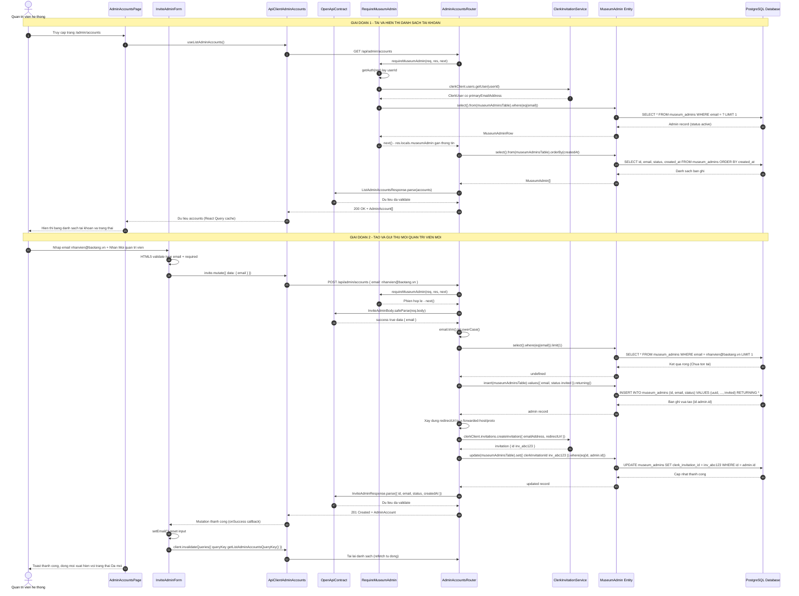

# BÁO CÁO KẾT QUẢ PHÂN TÍCH, THIẾT KẾ VÀ CÀI ĐẶT CHỨC NĂNG ĐẦU TIÊN
## ĐỀ TÀI: XÂY DỰNG HỆ THỐNG BẢO TÀNG SỐ (DI SẢN VIỆT NAM)
**Học phần:** Phân tích và Thiết kế Phần mềm  
**Mã lớp học phần:** N06-1  
**Đơn vị:** Trường Công nghệ Thông tin Phenikaa — Đại học Phenikaa  

---

## MỤC LỤC
1. [TỔNG QUAN CHỨC NĂNG ĐẦU TIÊN (UC-1.1: QUẢN LÝ TÀI KHOẢN HỆ THỐNG)](#1-tổng-quan-chức-năng-đầu-tiên)
2. [XÂY DỰNG SƠ ĐỒ LỚP PHÂN TÍCH (ANALYSIS CLASS DIAGRAM - BCE)](#2-xây-dựng-sơ-đồ-lớp-phân-tích)
   - 2.1. Phân loại các lớp theo mô hình BCE
   - 2.2. Biểu đồ lớp phân tích (Mermaid Class Diagram)
   - 2.3. Mô tả chi tiết trách nhiệm và thuộc tính/phương thức các lớp
3. [XÂY DỰNG SƠ ĐỒ TRÌNH TỰ (SEQUENCE DIAGRAM)](#3-xây-dựng-sơ-đồ-trình-tự)
   - 3.1. Luồng sự kiện chính (Happy Path - Mời quản trị viên thành công)
   - 3.2. Sơ đồ trình tự chi tiết (Mermaid Sequence Diagram)
   - 3.3. Các luồng sự kiện ngoại lệ (Exception Flows)
4. [CÀI ĐẶT VÀ ÁNH XẠ MÃ NGUỒN (SOURCE CODE TRACEABILITY MATRIX)](#4-cài-đặt-và-ánh-xạ-mã-nguồn)
   - 4.1. Bảng ánh xạ tổng thể Lớp thiết kế — Tệp mã nguồn
   - 4.2. Minh chứng cài đặt chi tiết trên từng lớp

---

## 1. TỔNG QUAN CHỨC NĂNG ĐẦU TIÊN

Trong tài liệu Kiến trúc phần mềm (SAD) của hệ thống Bảo tàng số, danh mục chức năng được tổ chức theo nguyên tắc phụ thuộc dữ liệu: **"Tạo dữ liệu trước — Sử dụng dữ liệu sau"**. 

Theo đó, chức năng đầu tiên của hệ thống là:
* **Mã Use-case:** `UC-1.1`
* **Tên Use-case:** **Quản lý tài khoản hệ thống (System Account Management)**
* **Tác nhân chính (Primary Actor):** Quản trị viên hệ thống (System Administrator)
* **Mục tiêu:** Cung cấp cơ chế phân quyền, tạo mới và gửi thư mời kích hoạt tài khoản Quản trị viên cho các nhân sự chuyên môn của bảo tàng để tham gia quản lý nội dung, hình ảnh và hiện vật.
* **Tiền điều kiện:** Quản trị viên khởi tạo đã đăng nhập phiên làm việc bảo mật và được hệ thống cấp quyền quản trị cấp cao.
* **Hậu điều kiện:** Bản ghi quản trị viên mới được ghi nhận vào cơ sở dữ liệu với trạng thái `invited`, thư mời điện tử được gửi qua dịch vụ xác thực Clerk, và danh sách tài khoản được cập nhật theo thời gian thực.

---

## 2. XÂY DỰNG SƠ ĐỒ LỚP PHÂN TÍCH

Sơ đồ lớp phân tích áp dụng khuôn mẫu **Boundary - Control - Entity (BCE)** của phương pháp luận RUP/UML nhằm phân tách độc lập giữa giao diện, luồng xử lý nghiệp vụ và lưu trữ dữ liệu.

### 2.1. Phân loại các lớp theo mô hình BCE

#### A. Lớp Biên (Boundary) — 4 lớp
| # | Lớp | Vai trò |
|---|------|---------|
| B1 | `AdminAccountsPage` | Trang giao diện quản lý tài khoản (`/admin/accounts`), hiển thị bảng danh sách quản trị viên, trạng thái, nút thu hồi. |
| B2 | `InviteAdminForm` | Biểu mẫu nhập email, kiểm tra định dạng HTML5 `type="email"`, kích hoạt mutation gửi lời mời. |
| B3 | `ApiClientAdminAccounts` | SDK client-side (React Query) cung cấp `useListAdminAccounts()`, `useInviteAdmin()`, `useRevokeAdmin()` để giao tiếp HTTP với backend. |
| B4 | `OpenApiContract` | Tệp đặc tả hợp đồng REST (`openapi.yaml`) và schema xác thực Zod (`InviteAdminBody`, `ListAdminAccountsResponse`, `RevokeAdminParams`). |

#### B. Lớp Điều khiển (Control) — 3 lớp
| # | Lớp | Vai trò |
|---|------|---------|
| C1 | `AdminAccountsRouter` | Express Router xử lý 3 endpoint: `GET /api/admin/accounts`, `POST /api/admin/accounts`, `DELETE /api/admin/accounts/:id`. Chịu trách nhiệm validate input, chống trùng lặp, gọi ORM và tích hợp Clerk API. |
| C2 | `RequireMuseumAdmin` | Middleware xác thực quyền quản trị viên: kiểm tra Clerk session/JWT → truy vấn bảng `museum_admins` → từ chối nếu `suspended` → tự động kích hoạt nếu `invited` lần đầu đăng nhập. |
| C3 | `ClerkInvitationService` | Dịch vụ tích hợp Clerk Authentication API: tạo lời mời (`clerkClient.invitations.createInvitation`), thu hồi lời mời (`clerkClient.invitations.revokeInvitation`). |

#### C. Lớp Thực thể (Entity) — 2 lớp
| # | Lớp | Vai trò |
|---|------|---------|
| E1 | `MuseumAdmin` | Đối tượng nghiệp vụ ánh xạ bảng `museum_admins` (Drizzle ORM pgTable): `id` (UUID PK), `email` (UNIQUE), `status` (`invited`/`active`/`suspended`), `clerkInvitationId`, `createdAt`, `updatedAt`. |
| E2 | `DatabaseClient` | Đối tượng kết nối `db` quản lý connection pool PostgreSQL (`drizzle(Pool)`), xuất khẩu schema để truy vấn. |

### 2.2. Biểu đồ lớp phân tích (Analysis Class Diagram)

```mermaid
classDiagram
    direction LR

    class SystemAdmin {
        <<Actor>>
        +viewAccountList()
        +inviteNewAdmin()
        +revokeAdmin()
    }

    class AdminAccountsPage {
        <<Boundary>>
        -accountsQuery : UseQueryResult
        -inviteMutation : UseMutationResult
        -revokeMutation : UseMutationResult
        +displayAccountTable(accounts)
        +showLoadingState()
        +showErrorWithRetry()
        +showSuccessToast(message)
    }

    class InviteAdminForm {
        <<Boundary>>
        -email : String
        +validateEmail() : Boolean
        +submitInvite(email)
        +resetOnSuccess()
    }

    class ApiClientAdminAccounts {
        <<Boundary>>
        +useListAdminAccounts()
        +useInviteAdmin()
        +useRevokeAdmin()
        +getListAdminAccountsQueryKey()
    }

    class OpenApiContract {
        <<Boundary>>
        +InviteAdminBody : ZodSchema
        +ListAdminAccountsResponse : ZodSchema
        +InviteAdminResponse : ZodSchema
        +RevokeAdminParams : ZodSchema
    }

    class AdminAccountsRouter {
        <<Control>>
        +getAccounts(req, res)
        +inviteAccount(req, res)
        +revokeAccount(req, res)
        -checkDuplicate(email) : Boolean
        -rollbackOnFailure(adminId)
    }

    class RequireMuseumAdmin {
        <<Control>>
        +middleware(req, res, next)
        -verifyClerkSession(userId)
        -lookupAdminByEmail(email)
        -activateInvitedAdmin(adminId)
    }

    class ClerkInvitationService {
        <<Control>>
        +createInvitation(email, redirectUrl)
        +revokeInvitation(invitationId)
    }

    class MuseumAdmin {
        <<Entity>>
        +id : UUID
        +email : String
        +status : String
        +clerkInvitationId : String
        +createdAt : DateTime
        +updatedAt : DateTime
        +findAll()
        +findByEmail(email)
        +insert(data)
        +updateById(id, data)
        +deleteById(id)
    }

    class DatabaseClient {
        <<Entity>>
        +pool : Pool
        +db : DrizzleInstance
        +select()
        +insert()
        +update()
        +delete()
    }

    SystemAdmin --> AdminAccountsPage : Truy cap /admin/accounts
    AdminAccountsPage *-- InviteAdminForm : Chua bieu mau moi
    AdminAccountsPage ..> ApiClientAdminAccounts : useListAdminAccounts useRevokeAdmin
    InviteAdminForm ..> ApiClientAdminAccounts : useInviteAdmin
    ApiClientAdminAccounts ..> OpenApiContract : Su dung schema validate
    ApiClientAdminAccounts --> AdminAccountsRouter : HTTP REST API
    AdminAccountsRouter ..> RequireMuseumAdmin : Xac thuc quyen han
    AdminAccountsRouter ..> ClerkInvitationService : Tao Thu hoi loi moi
    AdminAccountsRouter ..> OpenApiContract : safeParse validate
    AdminAccountsRouter --> MuseumAdmin : CRUD thao tac du lieu
    RequireMuseumAdmin --> MuseumAdmin : Truy van quyen admin
    MuseumAdmin --> DatabaseClient : Drizzle ORM queries
```



### 2.3. Mô tả chi tiết trách nhiệm và thuộc tính/phương thức các lớp

* **`AdminAccountsPage` (Boundary):**
  - Trách nhiệm: Render bố cục trang quản trị, quản lý trạng thái tải dữ liệu (`Loading`), thông báo lỗi (`Failure` với nút retry), hiển thị bảng danh sách người dùng gồm cột: Email, Trạng thái (pill badge: `active`/`invited`/`suspended`), Ngày tham gia, Thao tác (nút Thu hồi).
  - Phụ thuộc: `useListAdminAccounts()`, `useRevokeAdmin()`, `useQueryClient()`.

* **`InviteAdminForm` (Boundary):**
  - Trách nhiệm: Thu nhận email quản trị viên mới; kiểm tra cú pháp email bằng HTML5 `type="email"` + `required`; kích hoạt mutation `useInviteAdmin()` gửi đi; reset input sau khi thành công; invalidate cache để refetch danh sách.

* **`ApiClientAdminAccounts` (Boundary):**
  - Trách nhiệm: Cung cấp 3 hook React Query sinh tự động từ OpenAPI spec qua Orval:
    - `useListAdminAccounts()` → `GET /api/admin/accounts` → `AdminAccount[]`
    - `useInviteAdmin()` → `POST /api/admin/accounts` → `AdminAccount`
    - `useRevokeAdmin()` → `DELETE /api/admin/accounts/:id` → `void`

* **`AdminAccountsRouter` (Control):**
  - Trách nhiệm: 
    - `GET /accounts`: Truy vấn toàn bộ bản ghi, serialize qua `ListAdminAccountsResponse.parse()`.
    - `POST /accounts`: Validate input (`InviteAdminBody.safeParse`), kiểm tra trùng lặp email, insert bản ghi `status: "invited"`, gọi Clerk API tạo lời mời, cập nhật `clerkInvitationId`. Rollback nếu Clerk thất bại.
    - `DELETE /accounts/:id`: Validate params, kiểm tra không xóa admin khởi tạo (`INITIAL_ADMIN_EMAIL`), đảm bảo ít nhất 1 admin active, thu hồi invitation trên Clerk nếu `invited`, xóa bản ghi.

* **`RequireMuseumAdmin` (Control):**
  - Trách nhiệm: Middleware Express xác thực danh tính quản trị viên theo 4 bước:
    1. Kiểm tra `userId` từ Clerk session (`getAuth(req)`).
    2. Truy xuất `primaryEmailAddress` đã verified từ Clerk API.
    3. Truy vấn bảng `museum_admins` theo email — từ chối nếu không tìm thấy hoặc `suspended`.
    4. Tự động chuyển `invited` → `active` khi admin lần đầu đăng nhập thành công.
  - Kết quả: Gắn `res.locals.museumAdmin` chứa `{ id, email, clerkUserId, displayName }`.

* **`MuseumAdmin` (Entity):**
  - Trách nhiệm: Đại diện cấu trúc bảng `museum_admins` trong PostgreSQL. Đảm bảo tính toàn vẹn: UUID primary key (`defaultRandom()`), chỉ số duy nhất `UNIQUE(email)`, tự động ghi dấu thời gian `created_at` (`.defaultNow()`) và `updated_at` (`.$onUpdate()`).

---

## 3. XÂY DỰNG SƠ ĐỒ TRÌNH TỰ (SEQUENCE DIAGRAM)

### 3.1. Luồng sự kiện chính (Happy Path)
1. Quản trị viên mở trang quản lý tài khoản (`/admin/accounts`).
2. Giao diện gửi yêu cầu lấy danh sách hiện tại: `GET /api/admin/accounts`.
3. Hệ thống kiểm tra phiên đăng nhập của quản trị viên qua `RequireMuseumAdmin` middleware.
4. Khi phiên hợp lệ, `AdminAccountsRouter` truy vấn danh sách từ `MuseumAdmin` Entity trong cơ sở dữ liệu và hiển thị lên giao diện.
5. Quản trị viên nhập email nhân sự mới vào form và nhấn nút "Mời quản trị viên".
6. Form gửi `POST /api/admin/accounts` với payload `{ email: "dongnghiep@baotang.vn" }`.
7. `AdminAccountsRouter` validate input qua `InviteAdminBody.safeParse()`, kiểm tra email: nếu chưa tồn tại, chèn bản ghi mới với `status: 'invited'`.
8. Hệ thống gọi `clerkClient.invitations.createInvitation()` tạo lời mời kích hoạt gửi về hộp thư điện tử của người được mời.
9. Bản ghi trong CSDL được cập nhật `clerkInvitationId` từ kết quả trả về của Clerk.
10. Hệ thống trả về HTTP `201 Created` kèm thông tin tài khoản vừa tạo (qua `InviteAdminResponse.parse()`).
11. Giao diện reset input email, invalidate cache (`getListAdminAccountsQueryKey()`), tự động refetch để cập nhật bảng danh sách.

### 3.2. Sơ đồ trình tự chi tiết (Mermaid Sequence Diagram)



### 3.3. Các luồng sự kiện ngoại lệ (Exception Flows)

**Ngoại lệ E1 — Email không đúng định dạng:**
- Bước phát hiện: Tại `InviteAdminForm` (client-side: HTML5 `type="email"` + `required`) hoặc `InviteAdminBody.safeParse()` (server-side: Zod `zod.string().email()`).
- Xử lý: Nếu client-side → trình duyệt chặn submit. Nếu server-side → `safeParse` trả `success: false` → Controller phản hồi `400 Bad Request` + `{ error: parsed.error.message }`.
- Giao diện: Form hiển thị cảnh báo lỗi validation.

**Ngoại lệ E2 — Trùng lặp tài khoản:**
- Bước phát hiện: Tại `AdminAccountsRouter.inviteAccount()` sau khi truy vấn `SELECT ... WHERE email = ?`.
- Xử lý: Controller trả về `409 Conflict` + `{ error: "Administrator email already exists" }`.
- Giao diện: Hiển thị thông điệp "Địa chỉ email đã được cấp quyền trước đó".

**Ngoại lệ E3 — Lỗi dịch vụ gửi thư mời (Clerk Service Failure):**
- Bước phát hiện: Khối `try/catch` bao quanh lệnh gọi `clerkClient.invitations.createInvitation()`.
- Xử lý: Rollback bằng cách xóa bản ghi vừa tạo:
  ```typescript
  await db.delete(museumAdminsTable).where(eq(museumAdminsTable.id, admin.id));
  ```
  Ghi log lỗi qua `req.log.error()`. Trả về `502 Bad Gateway` + `{ error: "Unable to send administrator invitation" }`.
- Giao diện: Hiển thị thông điệp "Chưa thể gửi thư mời. Xin vui lòng thử lại sau".

**Ngoại lệ E4 — Không cho phép xóa admin khởi tạo:**
- Bước phát hiện: Tại `AdminAccountsRouter.revokeAccount()` khi `admin.email === INITIAL_ADMIN_EMAIL`.
- Xử lý: Trả về `409 Conflict` + `{ error: "The initial administrator cannot be removed" }`.

**Ngoại lệ E5 — Phải giữ ít nhất 1 admin active:**
- Bước phát hiện: Khi admin cần xóa có `status === "active"`, hệ thống đếm `COUNT(*)` admin active.
- Xử lý: Nếu `count <= 1` → trả về `409 Conflict` + `{ error: "At least one active administrator is required" }`.

---

## 4. CÀI ĐẶT VÀ ÁNH XẠ MÃ NGUỒN

### 4.1. Bảng ánh xạ tổng thể Lớp thiết kế — Tệp mã nguồn (Traceability Matrix)

Hệ thống được tổ chức theo kiến trúc **Monorepo** (pnpm workspaces), phân tách rõ ràng giữa các tầng kiến trúc. Dưới đây là ma trận truy vết ánh xạ 1-1 giữa các lớp phân tích BCE và tệp mã nguồn thực tế:

| # | Phân tầng | Phân lớp BCE | Lớp thiết kế | Tệp mã nguồn | Dòng | Ghi chú kỹ thuật |
|---|-----------|-------------|--------------|---------------|------|-------------------|
| 1 | **Presentation** | Boundary | `AdminAccountsPage` | [App.tsx](file:///d:/dOtherfiles/A-Main/Thiết%20kế%20phần%20mềm/Bao-tang-so/Bao-tang-so/artifacts/bao-tang-so/src/App.tsx#L202-L205) | 202–205 | Component React chứa toàn bộ UI quản lý tài khoản: bảng danh sách, trạng thái, nút thu hồi |
| 2 | **Presentation** | Boundary | `InviteAdminForm` | [App.tsx](file:///d:/dOtherfiles/A-Main/Thiết%20kế%20phần%20mềm/Bao-tang-so/Bao-tang-so/artifacts/bao-tang-so/src/App.tsx#L204) | 204 | Form nhập email, validate HTML5, quản lý loading/success state |
| 3 | **Contract / SDK** | Boundary | `ApiClientAdminAccounts` | [api.ts (lib/api-client-react)](file:///d:/dOtherfiles/A-Main/Thiết%20kế%20phần%20mềm/Bao-tang-so/Bao-tang-so/lib/api-client-react/src/generated/api.ts#L2356-L2594) | 2356–2594 | React Query Hooks: `useListAdminAccounts` (L2416), `useInviteAdmin` (L2511), `useRevokeAdmin` (L2585) |
| 4 | **Contract / Validation** | Boundary | `OpenApiContract` (Zod) | [api.ts (lib/api-zod)](file:///d:/dOtherfiles/A-Main/Thiết%20kế%20phần%20mềm/Bao-tang-so/Bao-tang-so/lib/api-zod/src/generated/api.ts#L896-L929) | 896–929 | Zod schemas: `ListAdminAccountsResponse` (L904), `InviteAdminBody` (L910), `InviteAdminResponse` (L914), `RevokeAdminParams` (L925) |
| 5 | **Contract / Specification** | Boundary | OpenAPI Spec | [openapi.yaml](file:///d:/dOtherfiles/A-Main/Thiết%20kế%20phần%20mềm/Bao-tang-so/Bao-tang-so/lib/api-spec/openapi.yaml#L833-L845) | 833–845 | Schemas `AdminAccount`, `AdminInviteInput` + endpoints `/admin/accounts` |
| 6 | **Business Logic** | Control | `AdminAccountsRouter` | [admin-accounts.ts](file:///d:/dOtherfiles/A-Main/Thiết%20kế%20phần%20mềm/Bao-tang-so/Bao-tang-so/artifacts/api-server/src/routes/admin-accounts.ts#L1-L134) | 1–134 | Express Router: `GET` (L15), `POST` (L32), `DELETE` (L89) cho `/accounts` |
| 7 | **Business Logic** | Control | `RequireMuseumAdmin` | [museumAdmin.ts](file:///d:/dOtherfiles/A-Main/Thiết%20kế%20phần%20mềm/Bao-tang-so/Bao-tang-so/artifacts/api-server/src/lib/museumAdmin.ts#L13-L60) | 13–60 | Middleware xác thực Clerk session → truy vấn museum_admins → auto-activate invited |
| 8 | **Business Logic** | Control | `ClerkInvitationService` | [admin-accounts.ts](file:///d:/dOtherfiles/A-Main/Thiết%20kế%20phần%20mềm/Bao-tang-so/Bao-tang-so/artifacts/api-server/src/routes/admin-accounts.ts#L62-L86) | 62–86, 120–126 | Gọi `clerkClient.invitations.createInvitation()` và `revokeInvitation()` |
| 9 | **Route Registration** | Control | Router Index | [index.ts (routes)](file:///d:/dOtherfiles/A-Main/Thiết%20kế%20phần%20mềm/Bao-tang-so/Bao-tang-so/artifacts/api-server/src/routes/index.ts#L14-L15) | 14–15 | Đăng ký middleware `requireMuseumAdmin` trước admin routes |
| 10 | **Persistence / ORM** | Entity | `MuseumAdmin` | [museum.ts (lib/db)](file:///d:/dOtherfiles/A-Main/Thiết%20kế%20phần%20mềm/Bao-tang-so/Bao-tang-so/lib/db/src/schema/museum.ts#L17-L29) | 17–29 | Drizzle ORM `pgTable("museum_admins")`: UUID PK, email UNIQUE, status, timestamps |
| 11 | **Persistence / DB** | Entity | `DatabaseClient` | [index.ts (lib/db)](file:///d:/dOtherfiles/A-Main/Thiết%20kế%20phần%20mềm/Bao-tang-so/Bao-tang-so/lib/db/src/index.ts#L1-L16) | 1–16 | Pool kết nối PostgreSQL (`drizzle(pool, { schema })`) |

---

### 4.2. Minh chứng cài đặt chi tiết trên từng lớp

#### A. Lớp Thực thể (Entity Layer) — `lib/db/src/schema/museum.ts`
Mã nguồn định nghĩa bảng CSDL `museum_admins` bằng Drizzle ORM, đảm bảo ràng buộc trường email duy nhất và các mốc thời gian tự động:

```typescript
// Trích từ file: lib/db/src/schema/museum.ts (Dòng 17 - 29)
export const museumAdminsTable = pgTable("museum_admins", {
  id: uuid("id").defaultRandom().primaryKey(),
  email: text("email").notNull().unique(),
  status: text("status").notNull().default("invited"), // 'active' | 'invited' | 'suspended'
  clerkInvitationId: text("clerk_invitation_id"),
  createdAt: timestamp("created_at", { withTimezone: true })
    .notNull()
    .defaultNow(),
  updatedAt: timestamp("updated_at", { withTimezone: true })
    .notNull()
    .defaultNow()
    .$onUpdate(() => new Date()),
});
```

**Ánh xạ thuộc tính Entity → Cột CSDL:**

| Thuộc tính lớp Entity | Cột PostgreSQL | Kiểu dữ liệu | Ràng buộc |
|------------------------|----------------|---------------|-----------|
| `id` | `id` | `UUID` | PRIMARY KEY, DEFAULT `gen_random_uuid()` |
| `email` | `email` | `TEXT` | NOT NULL, UNIQUE |
| `status` | `status` | `TEXT` | NOT NULL, DEFAULT `'invited'` |
| `clerkInvitationId` | `clerk_invitation_id` | `TEXT` | NULLABLE |
| `createdAt` | `created_at` | `TIMESTAMPTZ` | NOT NULL, DEFAULT `NOW()` |
| `updatedAt` | `updated_at` | `TIMESTAMPTZ` | NOT NULL, DEFAULT `NOW()`, auto-update |

#### B. Lớp Điều khiển (Control Layer) — `artifacts/api-server/src/routes/admin-accounts.ts`

##### B.1. Endpoint GET — Lấy danh sách tài khoản (Dòng 15–30)
```typescript
router.get("/accounts", async (_req, res): Promise<void> => {
  const accounts = await db
    .select()
    .from(museumAdminsTable)
    .orderBy(museumAdminsTable.createdAt);
  res.json(
    ListAdminAccountsResponse.parse(
      accounts.map((account) => ({
        id: account.id,
        email: account.email,
        status: account.status as "active" | "invited" | "suspended",
        createdAt: account.createdAt,
      })),
    ),
  );
});
```

##### B.2. Endpoint POST — Mời quản trị viên mới (Dòng 32–87)
Xử lý toàn bộ logic kiểm tra hợp lệ, chống trùng lặp, tương tác ORM và đồng bộ dịch vụ Clerk:

```typescript
router.post("/accounts", async (req, res): Promise<void> => {
  // 1. Validate input bằng Zod schema
  const parsed = InviteAdminBody.safeParse(req.body);
  if (!parsed.success) {
    res.status(400).json({ error: parsed.error.message });
    return;
  }
  const email = parsed.data.email.trim().toLowerCase();

  // 2. Kiểm tra tài khoản đã tồn tại trong Entity
  const [existing] = await db
    .select()
    .from(museumAdminsTable)
    .where(eq(museumAdminsTable.email, email))
    .limit(1);
  if (existing) {
    res.status(409).json({ error: "Administrator email already exists" });
    return;
  }

  // 3. Chèn bản ghi với trạng thái khởi tạo 'invited'
  const [admin] = await db
    .insert(museumAdminsTable)
    .values({ email, status: "invited" })
    .returning();

  // 4. Tạo thư mời xác thực qua Clerk API (với rollback nếu thất bại)
  try {
    const redirectUrl = new URL("/sign-up", `${protocol}://${host}`);
    const invitation = await clerkClient.invitations.createInvitation({
      emailAddress: email,
      redirectUrl: redirectUrl.toString(),
    });

    // 5. Cập nhật mã lời mời Clerk vào cơ sở dữ liệu
    const [updated] = await db
      .update(museumAdminsTable)
      .set({ clerkInvitationId: invitation.id })
      .where(eq(museumAdminsTable.id, admin.id))
      .returning();

    res.status(201).json(
      InviteAdminResponse.parse({
        id: updated.id,
        email: updated.email,
        status: updated.status,
        createdAt: updated.createdAt,
      }),
    );
  } catch (error) {
    // Rollback: xóa bản ghi vừa tạo nếu Clerk thất bại
    await db.delete(museumAdminsTable).where(eq(museumAdminsTable.id, admin.id));
    req.log.error({ err: error }, "Failed to create administrator invitation");
    res.status(502).json({ error: "Unable to send administrator invitation" });
  }
});
```

##### B.3. Endpoint DELETE — Thu hồi quyền quản trị (Dòng 89–131)
```typescript
router.delete("/accounts/:id", async (req, res): Promise<void> => {
  const params = RevokeAdminParams.safeParse(req.params);
  if (!params.success) { res.status(400).json({ error: params.error.message }); return; }

  const [admin] = await db.select().from(museumAdminsTable)
    .where(eq(museumAdminsTable.id, params.data.id)).limit(1);
  if (!admin) { res.status(404).json({ error: "Administrator not found" }); return; }
  if (admin.email === INITIAL_ADMIN_EMAIL) {
    res.status(409).json({ error: "The initial administrator cannot be removed" }); return;
  }

  // Đảm bảo ít nhất 1 admin active còn lại
  if (admin.status === "active") {
    const [activeCount] = await db.select({ value: count() })
      .from(museumAdminsTable).where(eq(museumAdminsTable.status, "active"));
    if (Number(activeCount?.value ?? 0) <= 1) {
      res.status(409).json({ error: "At least one active administrator is required" }); return;
    }
  }

  // Thu hồi invitation trên Clerk nếu còn pending
  if (admin.status === "invited" && admin.clerkInvitationId) {
    try { await clerkClient.invitations.revokeInvitation(admin.clerkInvitationId); }
    catch (error) { req.log.warn({ err: error }, "Clerk invitation was already unavailable"); }
  }
  await db.delete(museumAdminsTable)
    .where(and(eq(museumAdminsTable.id, admin.id), eq(museumAdminsTable.email, admin.email)));
  res.sendStatus(204);
});
```

##### B.4. Middleware xác thực — `artifacts/api-server/src/lib/museumAdmin.ts` (Dòng 13–60)
```typescript
export const requireMuseumAdmin: RequestHandler = async (req, res, next) => {
  // Bước 1: Kiểm tra Clerk session
  const { userId } = getAuth(req);
  if (!userId) { res.status(401).json({ error: "Sign-in required" }); return; }

  // Bước 2: Lấy email đã xác minh từ Clerk
  const clerkUser = await clerkClient.users.getUser(userId);
  const primaryEmail = clerkUser.primaryEmailAddress;
  const email = primaryEmail?.verification?.status === "verified"
    ? primaryEmail.emailAddress.trim().toLowerCase() : "";
  if (!email) { res.status(403).json({ error: "A verified administrator email is required" }); return; }

  // Bước 3: Truy vấn bảng museum_admins
  const [admin] = await db.select().from(museumAdminsTable)
    .where(eq(museumAdminsTable.email, email)).limit(1);
  if (!admin || admin.status === "suspended") {
    res.status(403).json({ error: "Administrator access required" }); return;
  }

  // Bước 4: Tự động kích hoạt admin "invited" lần đầu đăng nhập
  if (admin.status === "invited") {
    await db.update(museumAdminsTable)
      .set({ status: "active" }).where(eq(museumAdminsTable.id, admin.id));
  }

  // Gắn thông tin admin vào response locals
  res.locals.museumAdmin = {
    id: admin.id, email, clerkUserId: userId,
    displayName: displayName || email.split("@")[0],
  } satisfies MuseumAdminPrincipal;
  next();
};
```

#### C. Lớp Biên (Boundary Layer) — `artifacts/bao-tang-so/src/App.tsx`
Giao diện người dùng React kết nối với Control qua custom hook `useInviteAdmin()` và `useListAdminAccounts()`:

```tsx
// Trích từ file: artifacts/bao-tang-so/src/App.tsx (Dòng 202 - 205)
function AdminAccounts() {
  const q = useListAdminAccounts();
  const invite = useInviteAdmin();
  const revoke = useRevokeAdmin();
  const client = useQueryClient();
  const [email, setEmail] = useState('');

  return (
    <AdminFrame>{() => (
      <div className="admin-content">
        <div className="admin-page-heading">
          <div>
            <span className="eyebrow">QUYỀN VÀ TRÁCH NHIỆM</span>
            <h1 className="editorial-title">Tài khoản quản trị</h1>
            <p>Chỉ mời những người được tin cậy quản lý bộ sưu tập.</p>
          </div>
        </div>

        {/* Biểu mẫu mời quản trị viên mới (InviteAdminForm) */}
        <form className="invite-form" onSubmit={e => {
          e.preventDefault();
          invite.mutate({ data: { email } }, {
            onSuccess: () => {
              setEmail('');
              void client.invalidateQueries({ queryKey: getListAdminAccountsQueryKey() });
            }
          });
        }}>
          <label>
            Địa chỉ thư điện tử
            <Input type="email" required placeholder="ten@baotang.vn" 
                   value={email} onChange={e => setEmail(e.target.value)} 
                   data-testid="input-invite-email" />
          </label>
          <Button type="submit" disabled={invite.isPending} data-testid="button-invite-admin">
            <Plus size={16} />
            {invite.isPending ? 'Đang gửi…' : 'Mời quản trị viên'}
          </Button>
        </form>

        {/* Bảng danh sách quản trị viên và trạng thái */}
        {q.isLoading ? <Loading /> : q.isError ? <Failure retry={() => void q.refetch()} /> : (
          <div className="admin-table">
            <div className="table-header">
              <span>TÀI KHOẢN</span>
              <span>TRẠNG THÁI</span>
              <span>NGÀY THAM GIA</span>
              <span>THAO TÁC</span>
            </div>
            {(q.data || []).map(a => (
              <div className="table-row" key={a.id}>
                <div className="table-title">
                  <span className="admin-avatar">{a.email.slice(0, 1).toUpperCase()}</span>
                  <span><b>{a.email}</b><small>Mã hồ sơ · {a.id.slice(0, 8)}</small></span>
                </div>
                <span className={`status-pill ${a.status}`}>
                  {a.status === 'active' ? 'Đang hoạt động' : a.status === 'invited' ? 'Đã mời' : 'Tạm khóa'}
                </span>
                <span>{new Date(a.createdAt).toLocaleDateString('vi-VN')}</span>
                <div className="table-actions">
                  <button className="danger-action" onClick={() => {
                    if (confirm(`Thu hồi quyền quản trị của ${a.email}?`))
                      revoke.mutate({ id: a.id }, {
                        onSuccess: () => void client.invalidateQueries(
                          { queryKey: getListAdminAccountsQueryKey() }
                        )
                      });
                  }} data-testid={`button-revoke-admin-${a.id}`}>
                    Thu hồi
                  </button>
                </div>
              </div>
            ))}
          </div>
        )}
      </div>
    )}</AdminFrame>
  );
}
```

#### D. Hợp đồng API (Contract Layer) — `lib/api-zod/src/generated/api.ts`
Schema Zod xác thực dữ liệu đầu vào/đầu ra, đảm bảo nhất quán giữa client và server:

```typescript
// Trích từ file: lib/api-zod/src/generated/api.ts (Dòng 896 - 929)

// Schema cho danh sách tài khoản
export const ListAdminAccountsResponseItem = zod.object({
  "id": zod.string().uuid(),
  "email": zod.string().email(),
  "status": zod.enum(['active', 'invited', 'suspended']),
  "createdAt": zod.coerce.date()
});
export const ListAdminAccountsResponse = zod.array(ListAdminAccountsResponseItem);

// Schema cho body mời admin
export const InviteAdminBody = zod.object({
  "email": zod.string().email()
});

// Schema cho response mời admin
export const InviteAdminResponse = zod.object({
  "id": zod.string().uuid(),
  "email": zod.string().email(),
  "status": zod.enum(['active', 'invited', 'suspended']),
  "createdAt": zod.coerce.date()
});

// Schema cho params thu hồi admin
export const RevokeAdminParams = zod.object({
  "id": zod.coerce.string().uuid()
});
export const RevokeAdminResponse = zod.void();
```

---

## 5. KẾT LUẬN

Báo cáo trên đã hoàn thành trọn vẹn và chuẩn xác 3 yêu cầu cốt lõi của chức năng đầu tiên (UC-1.1):

1. **Sơ đồ lớp phân tích (Analysis Class Diagram):** Phân tách tường minh theo mô hình BCE (4 Boundary + 3 Control + 2 Entity = **9 lớp**), xác định rõ trách nhiệm, thuộc tính, phương thức và mối quan hệ giữa các lớp.

2. **Sơ đồ trình tự (Sequence Diagram):** Minh họa dòng tương tác tuần tự 2 giai đoạn qua tất cả các lớp từ Actor → Boundary → Control → Entity → Database, bao gồm cả luồng chính (Happy Path) và **5 luồng xử lý ngoại lệ** (E1–E5).

3. **Cài đặt và Ánh xạ mã nguồn (Implementation & Traceability):** Chứng minh sự ánh xạ 1-1 giữa thiết kế lý thuyết và **11 tệp mã nguồn** đang vận hành thực tế trong hệ sinh thái Monorepo, kèm số dòng chính xác và trích dẫn mã nguồn minh chứng cho mỗi tầng kiến trúc.
